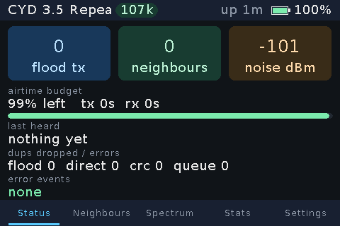
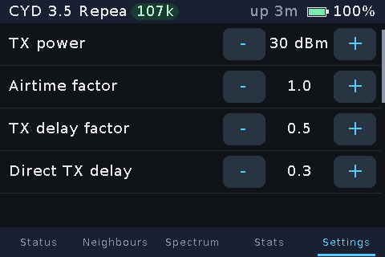

# MeshCore for the LCDWIKI CYD boards

MeshCore companion and repeater firmware for two "Cheap Yellow Display" ESP32 boards with an
Ebyte E22-900M30S (SX1262 + 1 W PA), with a colour touch UI drawn straight on the panel.

Module I used in this build is here: https://wirelesswizard.net/ols/products/bkbroiler-mesh-v1-pre-order

**Flash it in the browser:** [bkbroiler88.github.io/meshcore-cyd/flasher](https://bkbroiler88.github.io/meshcore-cyd/flasher/)
(desktop Chrome or Edge, Web Serial). Pick a board and role, plug in over USB, install.

Based on [meshcore-dev/meshcore](https://github.com/meshcore-dev/meshcore) at `81dbae5`
(2026-10-15). This repository is maintained independently; it is a snapshot plus the changes
below, not a fork with upstream history.

| Board | Panel | Touch | LoRa pins (CS / RST / BUSY / DIO1 / RXEN) |
|---|---|---|---|
| 2.8" ESP32-2432S028R (ST7789 panel) | 240x320, HSPI 14/13/12, CS 15, DC 2, BL 21 | XPT2046 on dedicated 25/32/39, CS 33 | 27 / 22 / 17 / 35 / 4 |
| 3.5" LCDWIKI ESP32-32E (ST7796) | 320x480, HSPI 14/13/12, CS 15, DC 2, BL 27 | XPT2046 on the LCD bus, CS 33 | 21 / 25 / 39 / 35 / 32 |

Both: SPI 18/19/23 shared with the SD slot (CS 5), E22 TXEN jumpered to its own DIO2, TCXO 1.8 V,
BOOT button GPIO 0, battery sense GPIO 34, no I2C.

## Screens

Repeater, 3.5" (480x320), Status page:



Repeater Settings page (stepper rows; radio and node rows need BOOT held while tapping):



Captured from the running board with `tools/screenshot.py` (long-press the node name in the
status bar, or send `screenshot` on the repeater's serial CLI).

## Environments

All in `variants/lcdwiki_cyd/platformio.ini`.

| Env | Role | UI |
|---|---|---|
| `LCDWIKI_28_ST7789_cyd_ble`, `LCDWIKI_35_cyd_ble` | companion (BLE + GPS) | colour touch UI (`examples/companion_radio/ui-cyd`) |
| `LCDWIKI_28_ST7789_repeater_cyd`, `LCDWIKI_35_repeater_cyd` | repeater | colour touch UI (`examples/simple_repeater/ui-cyd`) |
| `LCDWIKI_*_companion_radio_ble` / `_usb` | companion | stock MeshCore status UI |
| `LCDWIKI_*_repeater` | repeater | stock status UI |

Build from PowerShell (not Git Bash):

```
pio run -e LCDWIKI_35_cyd_ble
pio run -e LCDWIKI_35_cyd_ble -t upload --upload-port COM3
pio run -e LCDWIKI_35_cyd_ble -t mergebin      # single image for a flasher, .pio/build/<env>/firmware-merged.bin
```

Ready-made merged images (flash at 0x0) are in `dist/`. The easiest way to install one is the
browser flasher at [bkbroiler88.github.io/meshcore-cyd/flasher](https://bkbroiler88.github.io/meshcore-cyd/flasher/)
(desktop Chrome or Edge; the page source is `flasher/`). It installs any of the four images over
USB. Erase the flash when changing a board's role; touch calibration, theme and inversion live
in NVS and survive a plain reflash.

## What is in the port

- **Variant** `variants/lcdwiki_cyd/`: one directory, two boards (`LCDWIKI_28_ST7789` / `LCDWIKI_35`),
  LovyanGFX panel + touch, 4-point touch calibration stored in NVS (hold BOOT or press the screen at
  boot to redo it), runtime colour inversion, VSPI pinned for the radio.
- **Colour UI** for the companion: home tiles, contacts, channels, chat with on-screen keyboard and
  delivery ticks, stats, settings. Repeater: status with airtime budget, neighbours, stats, settings.
  Both: five themes, spectrum analyser (sweeps the band with the SX1262 while the mesh is held),
  finger-sized settings rows (stepper or button per row), heap counter in the status bar.
- **Dual core**: mesh, serial interfaces, sensors and clock on core 0; UI on core 1; one recursive
  mutex between them. Listener callbacks only set state.
- **PA gain**: `LORA_PA_GAIN_DB=10` makes every reported power an antenna figure. The app shows and
  accepts 30 dBm; the SX1262 is driven at 20. Do not raise the chip drive on the M30S.
- **GPS** on the companion envs: module TX to the pad labelled RX (GPIO 3), 9600 baud. UART0 RX is
  detached so the console does not see NMEA; serial logging still works, the serial CLI does not.
- **Repeater settings** go through the repeater's own CLI (`set tx`, `set af`, ...), so the same
  range checks apply as over the air. Radio and node rows need BOOT held while tapping.

## Offline map

The companion UI has an offline raster-map screen (Settings > Map). It reads tiles from a
microSD card in the slot that shares the radio's VSPI bus (`SDCARD_CS`, mounted through
`cyd_vspi()`), so no network is needed on the device.

Build a card with the vendored `tools/maptiles.py` (from the
[Cairn](https://github.com/cvhviz/Cairn) fork, MIT). It needs Python 3; `build` and `verify`
additionally need Pillow (`pip install pillow`).

```
python3 tools/maptiles.py presets                       # list the tile sources it may store offline
python3 tools/maptiles.py estimate --center 35.0,-97.0 --radius-mi 10 --zoom 8-16
python3 tools/maptiles.py build    --center 35.0,-97.0 --radius-mi 10 --zoom 8-16 --out E:/ --name okc-topo --title "OKC topo"
python3 tools/maptiles.py verify   E:/Maps/okc-topo
```

`--out` is the root of the SD card. The script writes `/Maps/<name>/manifest.txt` and
`/Maps/<name>/<z>/<bx>_<by>.l2t` tile blocks (P8RLE or RGB565, 256x256). The firmware scans
`/Maps` at open, streams one tile row at a time (a few KB of working set plus the FAT mount),
and frees it all when you leave the screen. Pan by dragging, and the node's own GPS position,
when it has a fix, is drawn as an overlay. `tools/MAPTILES.md` documents the card layout and
the on-disk formats in full.

Only tile sources whose terms allow storing tiles offline are offered by `presets`; the large
general-purpose tile services are deliberately excluded.

## Shared-code changes against upstream

- `src/helpers/radiolib/RadioLibWrappers.cpp`: optional `LORA_PA_GAIN_DB` subtraction in `setTxPower`.
- `src/helpers/radiolib/CustomSX1262.h`, `CustomSX1262Wrapper.h`: spectrum sweep primitives (guarded
  by `SPECTRUM_ANALYZER`).
- `examples/companion_radio/MyMesh.{h,cpp}`, `examples/simple_repeater/MyMesh.{h,cpp}`: PA-gain-aware
  power limits; repeater stats/neighbour accessors for the UI.
- `examples/companion_radio/main.cpp`, `examples/simple_repeater/main.cpp`: dual-core task under `UI_CYD`.
- `examples/companion_radio/ui-new/UITask.cpp`: touch-as-button support under `UI_HAS_TOUCH_BUTTON`.

## Known hardware notes

- Powering the CYD from a PC USB port while the PA transmits at 30 dBm can brown out the port and drop
  the serial device. Use an external 5 V supply or a powered hub on the bench.
- The 2.8" ST7789 panels vary in colour polarity between units; use Settings > Invert colours.
